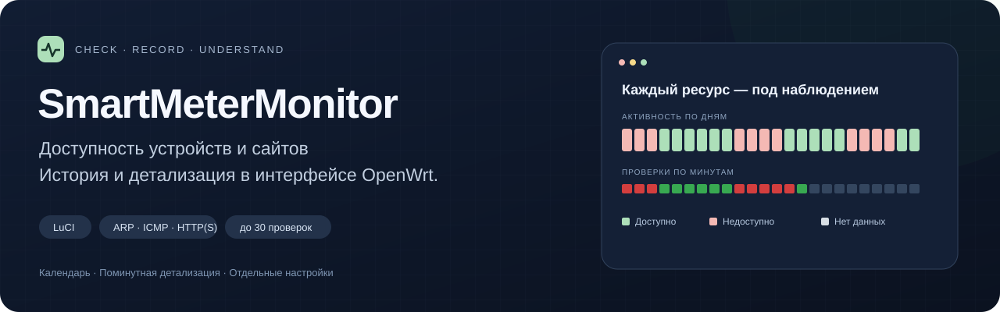
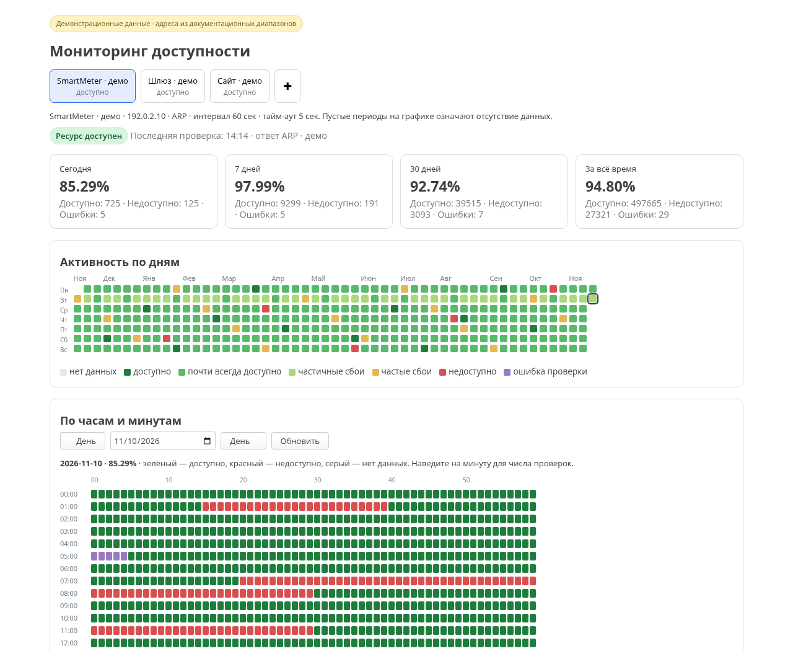
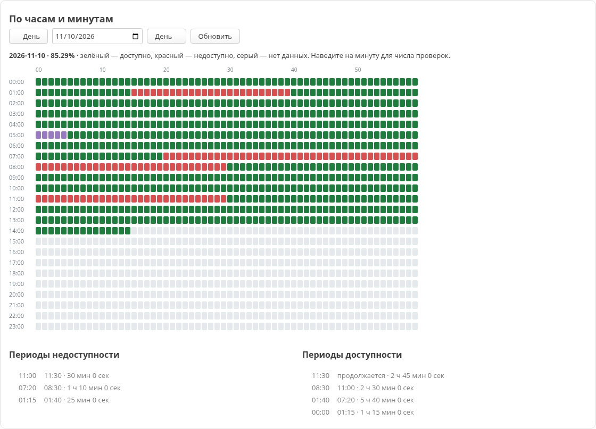
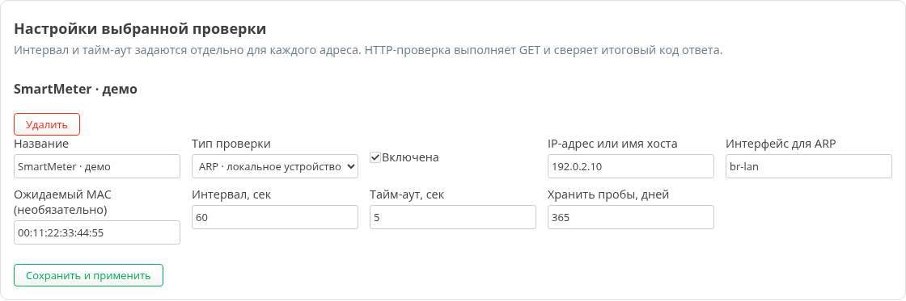
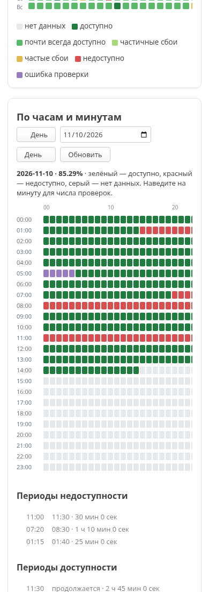

<div align="center">



**Независимые проверки устройств и сайтов, история доступности и детализация в LuCI.**


-56a86b?style=flat-square)

[Возможности](#возможности) · [Установка](docs/INSTALL.md) · [Интерфейс](#интерфейс) · [Основной проект](https://github.com/garik816/BlackoutMonitor)

</div>

> **Основной объединённый проект — [BlackoutMonitor](https://github.com/garik816/BlackoutMonitor).**
> Он включает этот монитор доступности, графики отключений, сравнение плана с фактом и аналитику очередей. SmartMeterMonitor сохраняется как отдельная версия монитора со своим исходным кодом и историей коммитов.

## Наблюдение за доступностью

SmartMeterMonitor выполняет независимые проверки локальных устройств, IP-адресов и веб-ресурсов. Для каждого адреса можно задать свой интервал и тайм-аут, посмотреть состояние сейчас и найти периоды доступности или сбоев в истории.

Откройте **Services → Мониторинг доступности** в LuCI: выберите ресурс сверху, день в календаре и нужный участок поминутной сетки.

## Интерфейс



*На снимках — рабочий интерфейс с демонстрационными данными, документальными IP-адресами и условным MAC. Личная история, реальные настройки и базы пользователя в репозиторий не включены.*

<details>
<summary><strong>Поминутная детализация и периоды доступности</strong></summary>



</details>

<details>
<summary><strong>Настройки выбранной проверки</strong></summary>



</details>

<details>
<summary><strong>Интерфейс на телефоне</strong></summary>



</details>

## Возможности

### Проверять разными способами

| Тип | Что проверяется | Когда полезен |
| --- | --- | --- |
| **ARP** | Ответ устройства в локальной сети; при необходимости — совпадение MAC | SmartMeter, локальные устройства и датчики |
| **ICMP** | Ответ IP-адреса или имени через ping | Шлюзы и сетевые узлы |
| **HTTP/HTTPS** | GET с переходами, проверкой TLS и ожидаемого HTTP-кода | Сайты, панели и веб-сервисы |

### Видеть историю

- Статус ресурса и время последнего измерения.
- Статистика за сегодня, 7 дней, 30 дней и всё время.
- Годовая сетка активности с выбором дня.
- Поминутная детализация: доступность, недоступность, ошибки и отсутствие данных.
- Отдельные списки **периодов доступности и сбоев** с временем начала, окончания и длительностью.
- Отметка о прерванном наблюдении, если нет подтверждённого времени окончания периода.

### Управлять несколькими ресурсами

- До **30 независимых проверок**.
- Отдельная история SQLite для каждого адреса.
- Добавление кнопкой **+** рядом с существующими проверками.
- Параметры только выбранного ресурса; черновики сохраняются при переключении вкладок.
- Сохранение полного списка с явным указанием удалённых проверок.
- Удаление проверки не удаляет её базу истории.

| Параметр | Допустимые значения |
| --- | --- |
| Интервал проверки | 5–3600 секунд |
| Тайм-аут | 1–60 секунд |
| Ожидаемый HTTP-код | 100–599 |
| Хранение проб | 1–3650 дней |

> Доступность ресурса и ошибка выполнения проверки учитываются отдельно. Пустой участок сетки означает отсутствие данных; пауза мониторинга не превращается в подтверждённый период доступности.

## Начать работу

Проверенная среда — **OpenWrt 25.12.6 x86/64 с LuCI**. Проект устанавливается копированием исходных файлов; готовый `.ipk`/`.apk` пакет пока не поставляется.

1. Подготовьте Python 3, SQLite, XML, `nmap`, `curl` и `ping`.
2. Скопируйте `files/` на роутер и настройте первый адрес.
3. Включите службу и откройте **Services → Мониторинг доступности**.

**[Пошаговая установка и обновление →](docs/INSTALL.md)**

В поставке находится только пример конфигурации. Существующий `/etc/config/smartmeter-availability` не заменяется автоматически, а проверка `main` продолжает использовать прежнюю базу.

## Данные и границы наблюдений

| Что | Где хранится |
| --- | --- |
| Параметры проверок | `/etc/config/smartmeter-availability` |
| История основной проверки `main` | `/root/smartmeter-availability.sqlite3` |
| История остальных проверок | `/root/smartmeter-<id>.sqlite3` |

Границы периодов строятся по наблюдавшимся пробам. Перезапуск службы, длительный пробел или устаревшие измерения не продолжают период как будто проверки всё это время выполнялись. Период, начавшийся до полуночи, сохраняет фактическое начало при просмотре выбранного дня.

Календарь показывает последние 365 дней; заполнение зависит от накопленной истории и срока хранения каждой проверки.

## Проверка исходников

```sh
python3 tests/test_availability.py
```

Проверки охватывают завершённые и текущие периоды, переход через полночь, перезапуски, устаревшие измерения и пропуски проб. Тестовые базы создаются во временном каталоге.

## Структура проекта

```text
files/
├── etc/config/                        # Пример конфигурации
├── etc/init.d/                        # Служба procd
├── usr/bin/                           # Сборщик доступности
├── usr/libexec/                       # Чтение статистики и сохранение настроек
├── usr/share/luci/menu.d/              # Пункт меню LuCI
├── usr/share/rpcd/acl.d/               # Права доступа
├── usr/share/ucode/luci/template/      # Версионирование ресурса интерфейса
└── www/luci-static/resources/view/     # Страница мониторинга

docs/                                  # Инструкция и изображения
tests/                                 # Проверки границ периодов
```

Для графиков отключений и сопоставления очередей используйте **[BlackoutMonitor](https://github.com/garik816/BlackoutMonitor)** — основной проект для совместного развития обоих разделов.
